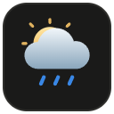

<p align="center"></p>

# Swamp Fox Labs Home Assistant Apps

Home Assistant apps (add-ons) by Swamp Fox Labs, KR4FCD. Each one adds its own
panel to the Home Assistant sidebar and works on phones and desktops, in light and
dark mode.

## Add this repository

[](https://my.home-assistant.io/redirect/supervisor_add_addon_repository/?repository_url=https%3A%2F%2Fgithub.com%2FSWFX2324%2Fswamp-fox-labs-ha-apps)

Or by hand:

1. In Home Assistant go to **Settings → Apps**, then open the app store.
2. Open the **⋮** menu → **Repositories**, and add:

   ```
   https://github.com/SWFX2324/swamp-fox-labs-ha-apps
   ```

3. The apps below appear under **Swamp Fox Labs Apps**. Pick one and press
   **Install**.

Requires Home Assistant OS or a Supervised install (amd64 or aarch64). Images are
prebuilt for both architectures, so installs and updates download a ready image
instead of building one on your machine.

## Apps

| | App | What it does |
| --- | --- | --- |
|  | [Ham Radio Dashboard](ham_dashboard) | HF propagation, band conditions and space weather for amateur radio, plus DX spots, repeaters, APRS, POTA, satellites and callsign lookup. |
|  | [ADS-B Tracker](adsb_tracker) | Find a flight by its number and follow it anywhere in the world on a live map, from public ADS-B data. |
|  | [Weather Observatory](weather_observatory) | Your Home Assistant weather as a full-page station, with radar, NWS alerts, a nearby station and air quality. |
|  | [Station Health](station_health) | One view-only page for your hosts, containers, UniFi network and VLANs, backups and updates, with uptime and what happened. |
|  | [Print Log](print_log) | Every print your Bambu Lab printer makes, with filament per AMS slot, cost and spools running low. Pause, stop and start prints from Home Assistant. |

Each app's page has screenshots and an overview, and its **Documentation**
(`DOCS.md`, also on the app's **Documentation** tab in Home Assistant) covers setup,
settings, troubleshooting and privacy.

## Updates

Home Assistant offers an update as soon as a new version is published here. Each
app's changelog (`CHANGELOG.md`, also shown in Home Assistant before you update)
lists what changed.

## Developing

Every app is plain Node.js with no dependencies, in its own folder:

```
<app>/
  config.yaml      Home Assistant app definition (name, version, options)
  Dockerfile       the image: Home Assistant's base image plus Node.js
  apparmor.txt     the enforced AppArmor profile
  app/             server and page
  tests/           unit and end-to-end tests, offline (outside services are faked)
  README.md        the app's page; DOCS.md its documentation; CHANGELOG.md
```

Each app's README says how to run it locally. All tests run with Node.js 24:

```bash
node --test "ham_dashboard/tests/*.test.js"
node --test "adsb_tracker/tests/*.test.js"
node --test "weather_observatory/tests/*.test.js"
node --test "station_health/tests/*.test.js"
node --test "print_log/tests/*.test.js"
```

### Releases

Every push to `main` that touches an app's folder runs two GitHub Actions:

- **Checks** (on every push and pull request): Home Assistant's app linter, a syntax
  check of every script, the unit and end-to-end tests, a check of the blueprints,
  and each image run under its enforced AppArmor profile.
- **Build images**: builds `ghcr.io/swfx2324/<app>-amd64` and `<app>-aarch64` for
  each app that changed, tagged with the version in its `config.yaml` and `latest`,
  and signs them with Cosign. Pull requests and other branches only build, so a
  released version's image is never replaced by unreleased code.

Home Assistant offers an update as soon as `config.yaml` on `main` has a new
version, and the images take a few minutes to build. An update started in that
window fails with "image not found"; it works once the build finishes.

## Security

See [SECURITY.md](SECURITY.md) to report a vulnerability.

## License

[MIT](LICENSE) © 2026 KR4FCD. The license covers the code in this repository. Data
shown by the apps is still subject to each source's own terms.
