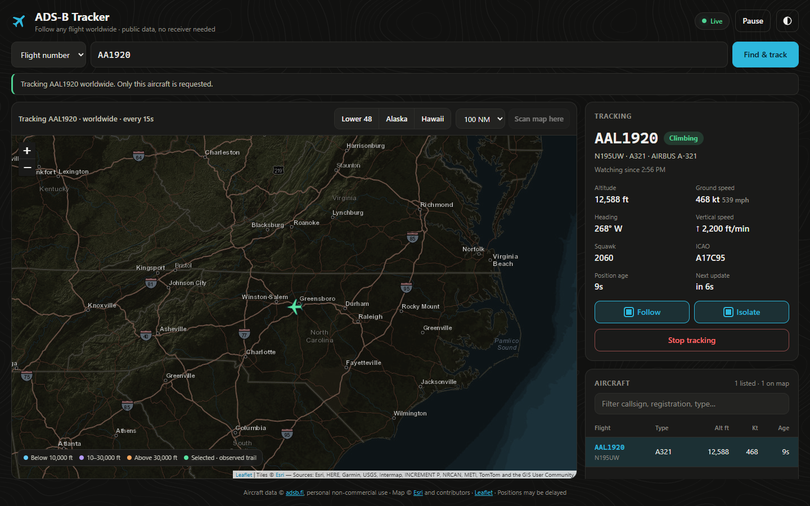
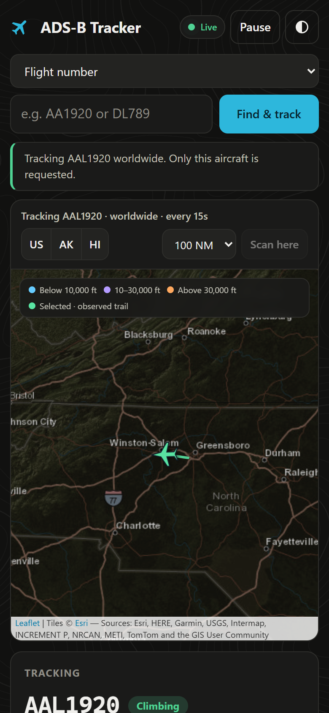

# ADS-B Tracker

Find a flight by its number and follow it anywhere in the world, right from the
Home Assistant sidebar. Uses public ADS-B data from [adsb.fi](https://adsb.fi): no
receiver, account or API key needed.

- Type a ticket flight number (AA1920, DL789), a callsign, a registration or an ICAO
  hex code. A single match is locked on, shown alone and followed on the map.
- Altitude, speed, heading, climb rate, squawk and the trail it has actually flown,
  updated every 15 seconds.
- Tracking ends by itself when the flight lands or the aircraft starts its next
  flight, so it never follows the wrong trip.
- Easy on the free feed: the map alone requests nothing, and every viewer shares one
  request budget and cooldown.
- Light and dark appearance, phone and desktop layouts.

<p>
  
  
</p>

See the [documentation](DOCS.md) for details.

Aircraft data © adsb.fi, for personal, non-commercial use. Map tiles © Esri.

## Developing

Plain Node.js with no dependencies. To preview it with a synthetic flight (Raleigh to
Los Angeles) behind a stand-in for Home Assistant's ingress proxy, so nothing touches
the real feed:

```bash
node adsb_tracker/tests/dev.js
```

Then open http://localhost:8098/api/hassio_ingress/Zx9_test-token/. The tests use a
fake adsb.fi and a fake clock:

```bash
node --test "adsb_tracker/tests/*.test.js"
```
