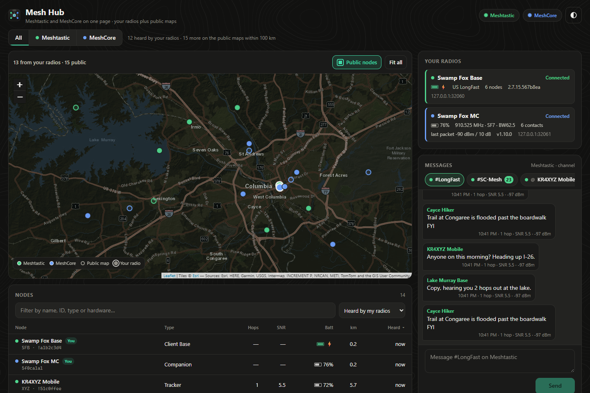
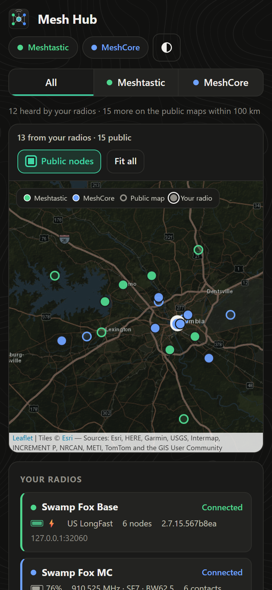

# Mesh Hub

Meshtastic and MeshCore on one page in the Home Assistant sidebar. Mesh Hub connects
to your own nodes over Wi-Fi and shows what they hear, on a map, in a node list and
in a chat. It also adds the public nodes near your home from the community maps.

- **Both networks, one page:** a Meshtastic node and a MeshCore companion radio, each
  over your network (TCP). Tabs show **All**, **Meshtastic** or **MeshCore**; green is
  Meshtastic, blue is MeshCore.
- **Your radios:** connection, battery, firmware and radio settings (region and
  preset, or frequency, spreading factor and bandwidth).
- **Map and node list:** every node your radios know, with hops, SNR, battery, distance
  and when it was last heard. Sort and filter the list, and click a node for details.
- **Messages:** your channels and direct messages, with SNR and hops for each one.
  Send from the page and see whether a node passed it on (✓) or the recipient
  confirmed it (✓✓). Messages are kept across restarts.
- **Public nodes nearby:** from [meshmap.net](https://meshmap.net) (Meshtastic, via the
  public MQTT server) and the [MeshCore map](https://map.meshcore.io), within a radius
  you choose around your Home Assistant home. They're hollow on the map.
- Light and dark appearance, phone and desktop layouts.

<p>
  
  
</p>

The screenshots show made-up radios and nodes.

See the [documentation](DOCS.md) for setup and details.

## Developing

Plain Node.js with no dependencies. The Meshtastic protobufs and the MeshCore
companion protocol are read and written by the app itself (`app/protobuf.js`,
`app/meshtastic.js`, `app/meshcore.js`). To preview it against two simulated radios
that chat every few seconds and made-up public maps, behind a stand-in for Home
Assistant's ingress proxy:

```bash
node mesh_hub/tests/dev.js
```

Then open http://localhost:8098/api/hassio_ingress/Zx9_test-token/. To try a real
node, set `MESHTASTIC_HOST` or `MESHCORE_HOST` (and `HOME_LAT`, `HOME_LON`) and run
`node mesh_hub/app/server.js`. The tests run against the simulated radios over real
TCP:

```bash
node --test "mesh_hub/tests/*.test.js"
```
