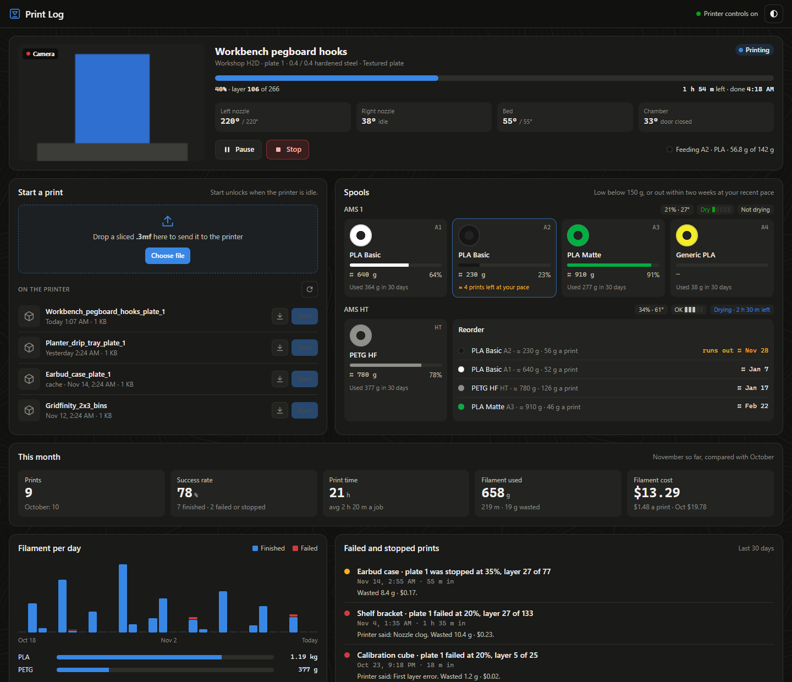
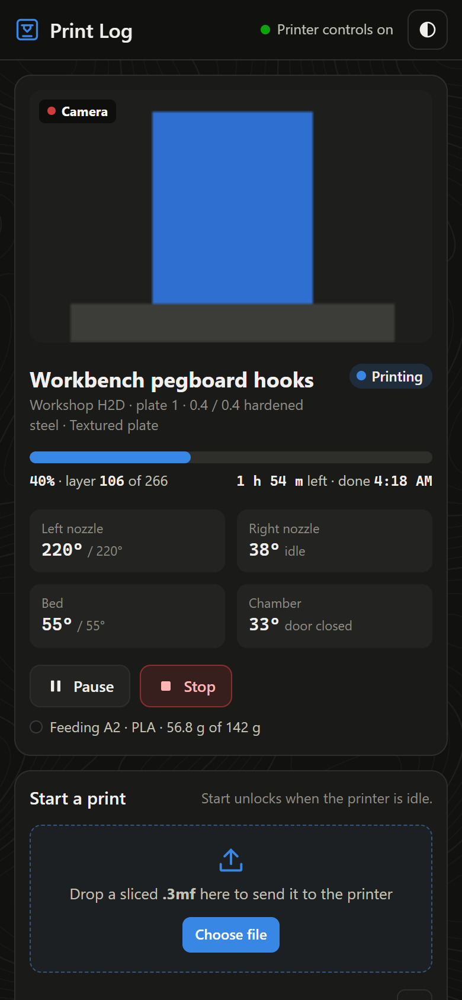
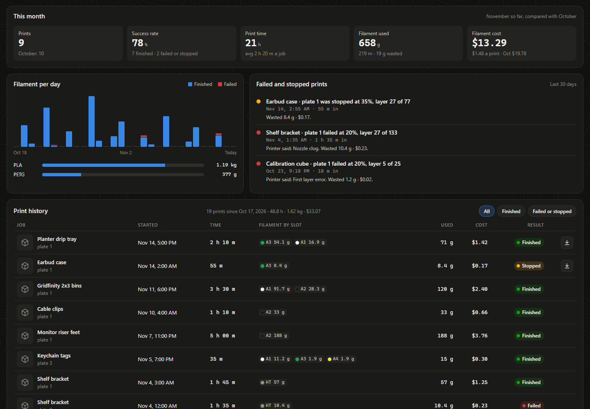
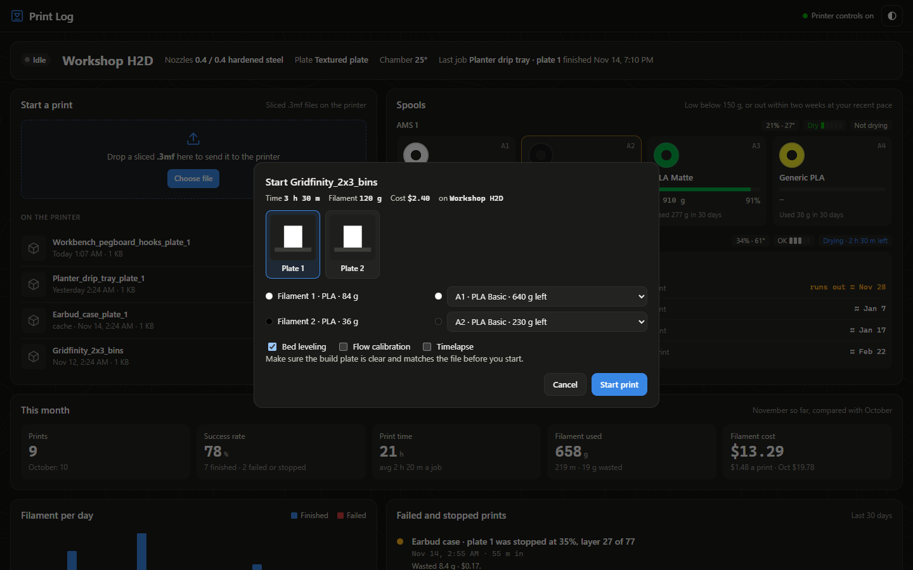

# Print Log

A page in the Home Assistant sidebar for your Bambu Lab printer. Home Assistant
shows what the printer is doing right now but keeps no history; Print Log records
every job: how long it took, the filament each AMS slot fed, what it cost, and
whether it finished, failed or was stopped. It tracks how much is left on each
spool and warns you before one runs out. You can also pause, resume and stop a
print, send a sliced file to the printer and start it, and download a file for
Bambu Studio.

<p>
  
  
</p>
<p>
  
</p>
<p>
  
</p>

The screenshots show a made-up printer and spools.

## What it shows

- **The print in progress:** camera, progress and layer, time left, nozzle, bed and
  chamber temperatures, and which slot is feeding. **Pause**, **Resume** and
  **Stop** (Stop asks first).
- **Start a print:** the sliced `.3mf` files on the printer. Pick a plate and the
  AMS slot for each filament (the app suggests the closest match by material and
  colour), then start it. Drop a new `.3mf` on the page to send it to the printer.
  Any file can be downloaded to open in Bambu Studio.
- **Spools:** every AMS slot (AMS, AMS 2 Pro, AMS HT and the external spool) with
  its filament, colour and what's left, each AMS's humidity and whether it's drying,
  and a **Reorder** list: when each spool will run out at your recent pace.
- **This month:** prints, success rate, print time, filament used and wasted, and
  what it cost, compared with last month.
- **Filament per day** for 30 days, and by material.
- **Failed and stopped prints:** how far each got, what the printer said (first
  layer error, nozzle clog and so on), and the filament wasted.
- **Print history:** every job with its plate, time, grams per slot, cost and
  result. Filter by finished or failed.
- Light and dark appearance, phone and desktop layouts.

## What you need

| | |
| --- | --- |
| [Bambu Lab integration](https://github.com/greghesp/ha-bambulab) (from HACS) | Required. Print Log reads the printer through it. |
| Recorder | Built in. On first start, Print Log reads the jobs in Recorder's history (10 days by default), then keeps its own log. |
| Developer LAN mode on the printer | Only for Pause, Resume, Stop and Start. Recent firmware ignores commands from Home Assistant without it. |
| The printer's access code | Only for the printer's files: listing them, sending a `.3mf`, starting one and downloading one. |

Without the last two, everything else (the history, spools, statistics and the
print in progress) still works. Turn **Printer controls** off on the app's
Configuration tab and the page only reads.

The [documentation](DOCS.md) covers setup, settings, troubleshooting and security.

## Safe by design

- Only Home Assistant administrators can open the panel.
- The app can call exactly two kinds of Home Assistant service: the printer's own
  Pause, Resume and Stop buttons, and the Bambu Lab integration's "print a file"
  action. Anything else is refused inside the app before it's sent.
- Every action is checked against the printer's state first. You can't stop what
  isn't printing, or start a file while the printer is busy.
- It only sends `.3mf` files to the printer, only to its storage, and only talks to
  the address the Bambu Lab integration reports for it, on your network.
- Home Assistant's token and the printer's access code stay inside the app and never
  reach the browser. No other service, no telemetry, and no third-party code
  packages.

## Developing

Plain Node.js with no dependencies. To preview it against a fake Home Assistant and
a fake printer, behind a stand-in for Home Assistant's ingress proxy:

```bash
node print_log/tests/dev.js
```

Then open http://localhost:8186/api/hassio_ingress/Zx9_test-token/. `FAKE_WORLD`
switches on scenarios such as an idle printer, Developer LAN mode off or no AMS;
they're listed in `tests/fixtures/fake-printer.js`. The tests run offline:

```bash
node --test "print_log/tests/*.test.js"
```
