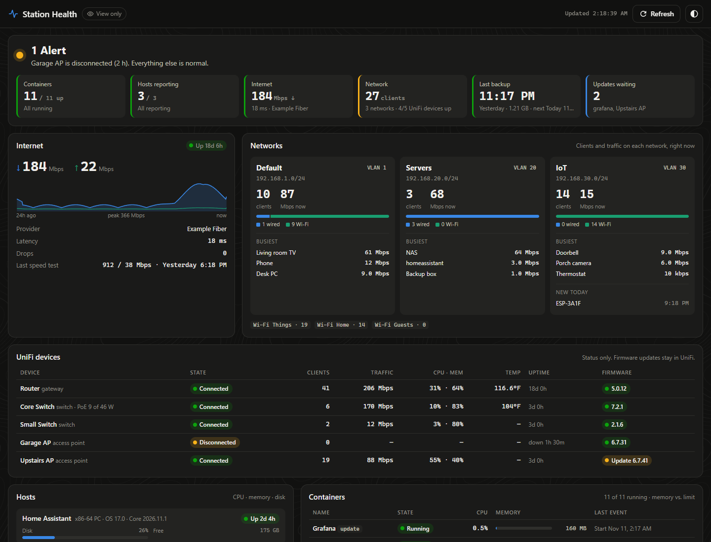
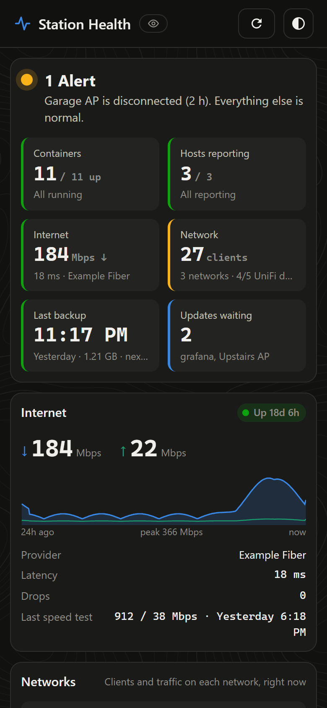
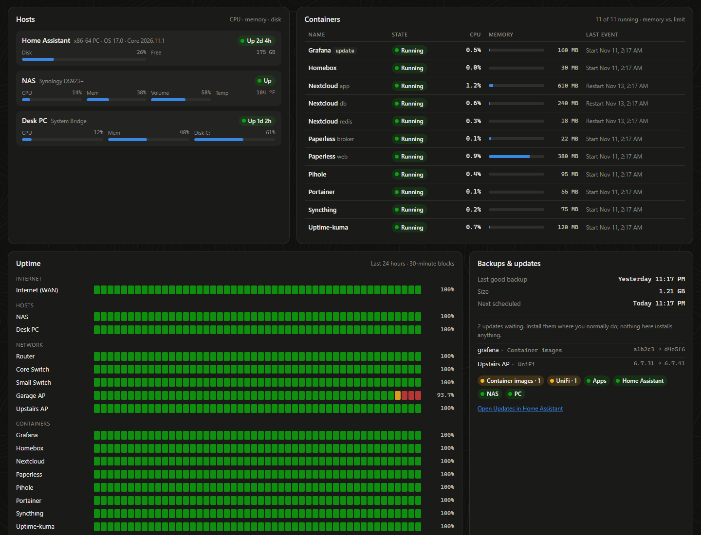
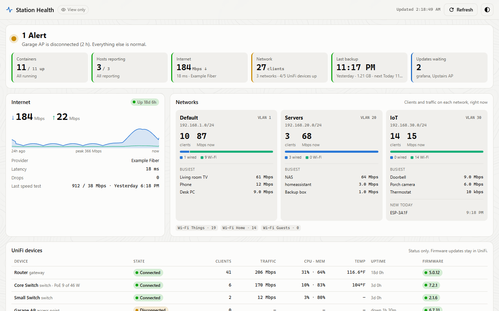

# Station Health

One view-only page in the Home Assistant sidebar for everything you run: Home
Assistant itself, your NAS and PCs, Docker containers, your UniFi network and its
VLANs, backups and updates. It shows any alerts at a glance, and what changed just
before something went down.

<p>
  
  
</p>
<p>
  
</p>
<p>
  
</p>

The screenshots show a made-up home.

## What it shows

- **Alerts at the top:** a banner that counts them ("2 Alerts") and lists each one:
  a host or PC not reporting, a container that stopped, a UniFi device offline, the
  internet down, a failed or old backup, or an integration that won't load.
- **Hosts:** Home Assistant's own machine (uptime, disk), a Synology NAS (CPU,
  memory, volume, drives, temperature) and PCs with System Bridge (CPU, memory, disk).
  A PC that's asleep shows as "no data", not as down.
- **Containers** from Portainer, grouped by compose stack, with CPU, memory against
  each container's limit, the last Docker event and whether a newer image is out.
- **UniFi devices:** every gateway, switch and access point with its state, clients,
  traffic, CPU and memory, temperature, PoE use, uptime and firmware.
- **Networks (VLANs):** each network with its VLAN ID and subnet, clients (wired and
  Wi-Fi), traffic, the busiest clients and devices first seen today.
- **Internet:** download and upload right now, a 24-hour graph, latency, drops and the
  console's last speed test.
- **Uptime** for the last 24 hours in 30-minute blocks, for every host, UniFi device,
  container (or stack) and the internet.
- **Recent Activity** (collapsible): the last 7 days of outages, updates installed
  and new devices on the network. Each outage lists any update or container event in
  the 15 minutes before it, which often points straight at the cause.
- **Backups and pending updates**, with a link to install them in Home Assistant.
- Light and dark appearance, phone and desktop layouts.

## Supported integrations

The page builds itself from what your Home Assistant has. Every panel is optional: if
you don't have an integration, its panel doesn't appear. With none of them, you still
get Home Assistant's own host, backups, updates and the log.

| Integration | What it adds | Needed |
| --- | --- | --- |
| Home Assistant (Supervisor) | Home Assistant's machine: uptime, disk, OS and Core versions | Built in |
| Backup | Last good backup, size, next scheduled backup, failed attempts | Built in (automatic backups) |
| Update entities | Every pending update, grouped by where it comes from | Built in |
| Recorder | The uptime chart and the 7-day log | Built in |
| [Synology DSM](https://www.home-assistant.io/integrations/synology_dsm/) | NAS host: CPU, memory, volume use, drive and volume health, temperature | Optional |
| [System Bridge](https://www.home-assistant.io/integrations/system_bridge/) | PC hosts: CPU, memory, disk, uptime | Optional |
| [Portainer](https://www.home-assistant.io/integrations/portainer/) | Containers: state, CPU, memory against the limit, Docker events, image updates | Optional |
| [UniFi Network](https://www.home-assistant.io/integrations/unifi/) | UniFi devices (state, CPU, memory, uptime, firmware) and clients per Wi-Fi network | Optional |
| UniFi console (direct, View Only login) | Networks (VLANs) with clients and traffic, the internet connection, device traffic, temperature and PoE | Optional, set on the app's Configuration tab |

Home Assistant's UniFi integration doesn't report each VLAN or the internet
connection, which is why the app can also read your UniFi console itself, with a
**View Only** local account that can't change anything. See the
[documentation](DOCS.md#adding-your-unifi-console-vlans-and-internet) for the steps.

## View only, and private

- Nothing on the page can start, stop, restart or change any device. The one thing
  it saves is its own note of which UniFi devices you've marked as stored. The app only sends
  read requests to Home Assistant and, after signing in, only GET requests to the
  UniFi console.
- The panel is for Home Assistant administrators only.
- Home Assistant's token and the UniFi password stay inside the app and never reach
  the browser.
- It only connects to Home Assistant and the UniFi address you enter. No other
  service, no telemetry, and no third-party code packages.

See the [documentation](DOCS.md) for setup, settings, troubleshooting and security.

## Developing

Plain Node.js with no dependencies. To preview it against a fake Home Assistant and a
fake UniFi console, behind a stand-in for Home Assistant's ingress proxy:

```bash
FAKE_WORLD=ap_down node station_health/tests/dev.js
```

Then open http://localhost:8090/api/hassio_ingress/Zx9_test-token/. `FAKE_WORLD`
switches on scenarios such as outages or a plain Home Assistant with no extra
integrations (`bare`); they're listed in `tests/fixtures/fake-world.js`. The tests
run offline:

```bash
node --test "station_health/tests/*.test.js"
```
