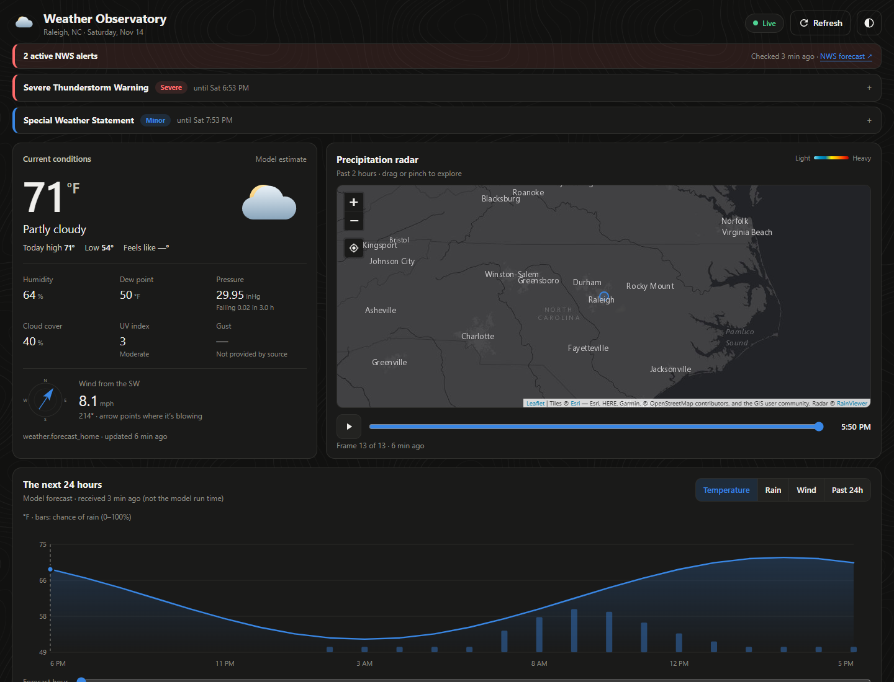
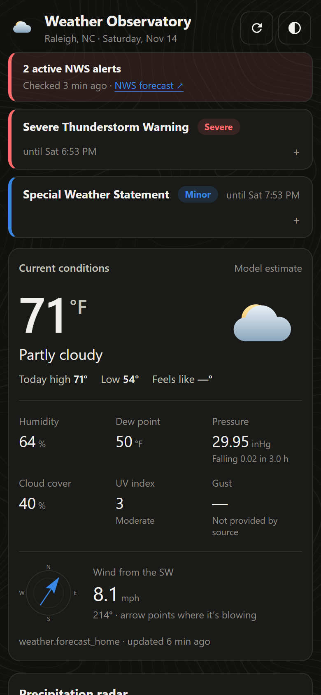
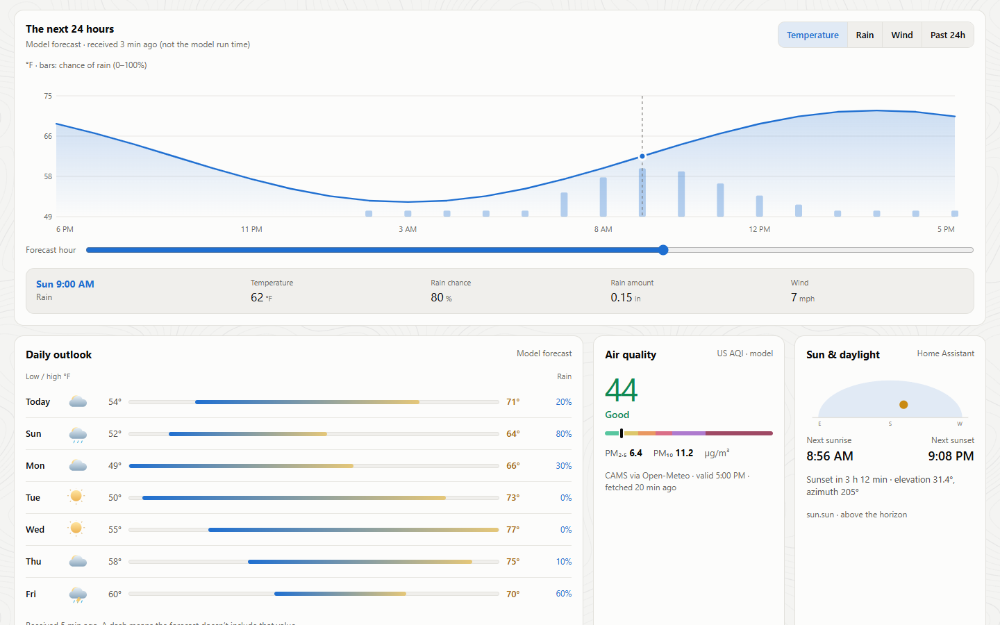

# Weather Observatory

A full-page weather station for the Home Assistant sidebar, built on the weather
entity you already have (for example Met.no). No account or API key needed.

- Current conditions, a 24-hour chart of temperature, rain or wind (tap or drag to
  read any hour), the daily outlook, and the last 24 hours as Home Assistant recorded
  them.
- Animated precipitation radar for your area with pan, pinch zoom and frame scrubbing.
- National Weather Service alerts and the nearest station's measurements (US).
- Modeled air quality (US AQI, PM2.5, PM10) and the sun's position, sunrise and
  sunset.
- Every panel shows where its data came from and how old it is. A missing value
  stays blank instead of turning into 0, and a failed refresh says so rather than
  showing old data as current.
- Public services see only your area rounded to about 11 km, never your exact
  location.
- Light and dark appearance, phone and desktop layouts.

<p>
  
  
</p>
<p>
  
</p>

See the [documentation](DOCS.md) for setup, settings and what each panel shows.

Radar © RainViewer. Alerts and observations: National Weather Service. Air quality:
CAMS via Open-Meteo. Map tiles © Esri.

## Developing

Plain Node.js with no dependencies. To preview it against a fake Home Assistant and
fake weather services, behind a stand-in for Home Assistant's ingress proxy:

```bash
FAKE_WORLD=alerts FAKE_RADAR=real node weather_observatory/tests/dev.js
```

Then open http://localhost:8096/api/hassio_ingress/Zx9_test-token/. `FAKE_WORLD`
switches on scenarios such as alerts or outages (listed in
`tests/fixtures/fake-world.js`); `FAKE_RADAR=real` shows real RainViewer radar.
The tests run offline:

```bash
node --test "weather_observatory/tests/*.test.js"
```
